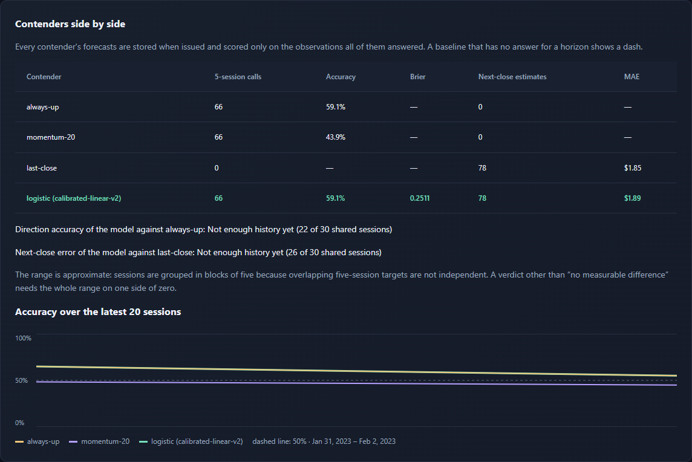

# MarketLens
A local course project that stores market forecasts and measures them against simple
baselines, with guided learning and paper portfolios.

**At a glance.** MarketLens is a measuring tool, not a model: every contender's forecast
is stored before its outcome exists, nothing is ever rewritten, and every contender is
scored on the same observations. Its own trained model is just one contender. On
2,871 five-session calls from 2023-01-03 to 2026-11-02 it is right 52.35% of the time;
always guessing Up gets 55.28%. With overlapping calls taken into account, the difference
is −2.9 points (approximate 95% range −6.9 to +1.1), so the honest verdict on screen is
*no measurable difference*. Five instruments instead of three give the same verdict.



- Offline replay of 1,213 real sessions and free current quotes for SPY, IEF and GLD
- Always-up, momentum, last-close and a calibrated logistic model as contenders
- Automatic retraining after every session, with frozen versions compared on the same 20 sessions
- 47 automated tests, 2 browser walkthroughs and 18 deliberate-bug checks that the tests all catch

## Install and run

Tested on Windows with **Python 3.13.2**. Use Python 3.13 and the pinned packages:

```powershell
python -m venv .venv
.\.venv\Scripts\python -m pip install -r requirements.txt
.\.venv\Scripts\Activate.ps1
python app.py
```

If PowerShell blocks activation, run `.\.venv\Scripts\python app.py` directly.
On macOS/Linux use `source .venv/bin/activate` after creating the environment.
Open http://127.0.0.1:8080. Stop with Ctrl+C. Optional flags:
`python app.py --no-browser --port 8081 --database .runtime/demo.sqlite3`.
Node/OpenSpec are development tools; the application does not need them at runtime.

Current mode attempts free Yahoo Finance retrieval in a background worker. No paid
credentials are needed. Dependencies need downloading once; **Historical replay**
then works without internet. The server binds only to this computer. It is a shared
local workspace, with no accounts, payments or real orders.

## What the MVP does

Choose a learning goal, topics, experience, risk preference and horizon. Browse nine
searchable guides, save reading and compare three fixed educational allocations.
Preferences and reading progress stay in browser localStorage; changing them never
changes existing holdings. The English interface includes six connected views.

Select a data mode above the tabs:

- **Current market data:** SPY, IEF and GLD five-minute observations, each with source,
  observation/fetch timestamps and current/stale/closed/unavailable state. Provider
  delay is unknown. Polling every five minutes is not guaranteed data latency.
  Quotes older than 30 minutes during an open session are stale. Failures retain
  original cached timestamps with an error; they never switch to replay.
- **Historical replay:** a sourced 1,213-session snapshot, 2022-01-03 to 2026-11-02; 2022 is warm-up,
  practice starts on 2023-01-03. Each Next trading day runs the same actual training,
  issuance and evaluation pipeline against a simulated clock, with no network calls.
- **Legacy 2024 replay:** read-only inspection of an existing original experiment.
  Its momentum strength remains a heuristic, never a calibrated probability.

Each instrument shows a **five-trading-session Up/Down call** and a separate
**next-session USD closing-price estimate**, reference/target dates and model version.
The headline for the Up/Down call is the **measured hit rate** of earlier evaluated
calls in the same 0.2-wide confidence band, shown once at least 30 such calls exist.
The model's own estimate appears only in small print, labelled uncalibrated (see
*Spike: full replay* below for why).
Intraday quotes do not rewrite these daily forecasts. Exchange sessions account for
holidays, daylight saving and early closes. The adapter conservatively excludes
same-exchange-date daily bars, even after close, because they can be provisional.

The model uses trailing 1/5/20-session returns, 20-session volatility and instrument
identity. Logistic classification and ridge return regression fit only past labels.
At least 120 fitting sessions precede 40 calibration sessions, with a five-session
purge. Preprocessing fits only the fitting partition. Sigmoid calibration uses
scikit-learn 1.9.1's pinned Platt implementation, explicitly aligned to fitted
classes (including Flat); its internal `_SigmoidCalibration` API is covered by tests
and must be rechecked before a dependency upgrade. Missing Up/Down coverage or a
new calibration class blocks activation. A fitted Flat class with no calibration
examples uses sigmoid target smoothing, not fabricated observations; counts are
shown and reliability for rare/unseen outcomes is unproven. See the
[calibration guide](https://scikit-learn.org/stable/modules/calibration.html).

Automatic retraining runs on new eligible shared daily history while the server is
open. Startup catches up only to the latest cutoff, without inventing missed live
forecasts. Failed or interrupted runs retain the previous usable model and a visible
reason. No scheduled work runs while the app/computer is off. This is automatic
**model retraining**, not an operating-system restart service.

Model history keeps mistakes, pending outcomes, model IDs and actual issuance times.
Equal five-session closes count as incorrect for either strict direction. A $100
price estimate versus an actual $102 close has $2 error and 1.9608% percentage error.
It reports accuracy, MAE, MAPE, selected-direction Brier error and five reliability
bins with counts. Always-Up, 20-session momentum and last-close baselines are stored
as contenders and use the same observations (see *Contenders side by side*). Consecutive frozen versions are also compared on their shared
next 20 reference sessions, with pending/partial/complete status. Newer can be worse;
overlapping targets are not independent. No accuracy or profit guarantee is made.

Paper portfolios accept $100–$1,000,000 and fixed fractional holdings. Current-mode
entry requires all three usable quotes; the most recent completed session is valid
while the market is closed. Subsequent cached/partial valuations identify each
component's timestamp. There are no distributions, fees, taxes, slippage, contributions
or executed rebalancing. Current and replay portfolios and resets are independent.

## Class demonstration

1. Start the app; complete onboarding and save/read a guide. Show the library and
   educational reasons for the Balanced example.
2. In Current market data, inspect all three quote timestamps/source/freshness and
   both forecast targets in Practice. Outside exchange hours the quotes say closed.
   Initial history/model bootstrap can take several seconds. Apply Balanced $10,000.
3. Explicitly select Historical replay. Apply a separate Balanced $10,000 portfolio.
   Advance once: prices/P&L change, the first price errors mature and training runs
   automatically. Advance five sessions to show correct and incorrect direction calls.
4. Advance **26 sessions in total** from the initial replay date. Open Model history:
   inspect errors, baselines, reliability, training runs and a complete frozen-version
   comparison. Show both improvements and regressions, without changing old forecasts.
5. Show failure behavior using `python tests/browser_mvp.py`: its explicitly fake
   provider produces a quote update and then an outage. It asserts cached values,
   stale timestamps, independent resets and the same offline replay demonstration.
   These fixtures are not claimed as proof of real-source access.
6. Separately run `python scripts/smoke_market_data.py` for actual free intraday and
   daily retrieval for all three symbols. An outage is reported, never hidden.

## Verification and persistence

```powershell
python -m unittest discover -s tests -p "test*.py" -v
python -m pip install playwright==1.63.0
python tests/browser_journey.py
python tests/browser_mvp.py
python scripts/mutation_check.py
python scripts/contenders.py
python scripts/contenders.py --universe
python scripts/smoke_market_data.py
openspec validate --all --strict
```

Browser checks were last run with Playwright 1.63.0 (they also look for it in
`.runtime/browser-tools`) and use installed Microsoft Edge, isolated browser state and temporary
databases; they do not modify your portfolio. Screenshots go under `.runtime/`.
On 2026-09-26, real-source checks retrieved all three intraday observations and 1,255
common completed sessions through 2026-09-25; current-model training succeeded.
All 25 deterministic backend/API tests and both browser workflows passed then. On
2026-11-04 a fresh clone with a new Python 3.13.2 environment from `requirements.txt`
passed all 47 tests and both browser workflows, and `scripts/mutation_check.py` reported
all 18 deliberate one-line bugs caught.
The deterministic tests separately cover calendars, chronology, calibration,
migration rollback, worker responsiveness, cache failures, metrics and mode isolation.

SQLite/model artifacts live under ignored `.runtime/`. Before the first additive
migration, an existing database is backed up as `marketlens.sqlite3.pre-mvp.bak`.
Legacy records and browser keys are preserved. A failed migration rolls back; retain
the backup. For recovery stop the app, preserve the failed database separately and
restore the backup with the previous application version. Never overwrite a backup
just to retry. For a fresh independent demo choose a new `--database` filename.

Yahoo's chart endpoint is unofficial, best effort and may reject access. This is a
personal educational integration, not a licensed commercial data feed. Retrieval
success does not grant redistribution or commercial-use rights; review the
[provider's terms](https://legal.yahoo.com/us/en/yahoo/terms/otos/index.html) before
any other use. See [data provenance](data/README.md) for exact sources and identities.

Every change since the MVP went through OpenSpec, in [openspec/changes](openspec/changes/):
`marketlens-course-mvp`, `contender-leaderboard`, `revise-demo-description` and
`fresher-wider-data`. Decisions are append-only in [PLANNING_LOG.md](PLANNING_LOG.md).

## Spike: full replay

`python scripts/spike_replay.py` runs the whole snapshot headlessly (one walk-forward
step per session, retraining at each cutoff, temporary database, no network) and prints
the metrics. The figures below are the dated record of the original 753-session
2022–2024 snapshot (501 steps). Committed output: [scripts/spike_replay_output.txt](scripts/spike_replay_output.txt).
Measured on 2026-10-03: 348.7 s (0.696 s/step); 1,491 evaluated five-session calls,
accuracy 52.3% vs always-Up 54.8% and momentum 51.8%; Brier 0.266, worse than a
constant 0.5 (0.250); next-session MAE $1.586 vs last-close $1.584. Confidence bands
promise 55/67/85% and deliver 52/52/55% (n = 755/678/58). The model has no measured
edge, so its confidence is not presented as a probability.

## Contenders side by side

MarketLens measures models; the trained model is one replaceable contender. Each
contender in [marketlens/contenders.py](marketlens/contenders.py) has `fit(rows)` and
`predict(rows)` and is only ever given the sessions up to its reference session.
`python scripts/contenders.py` walks the replay from 2023-01-03 to 2026-11-02 with
always-up, 20-session momentum, last-close and the logistic model, and scores every
contender on the same observations. `--universe` adds QQQ (Nasdaq-100) and IWM (US small
caps) from [data/universe_prices.csv](data/universe_prices.csv); the app itself still shows
SPY, IEF and GLD. Committed outputs: [scripts/contenders_output.txt](scripts/contenders_output.txt)
and [scripts/contenders_universe_output.txt](scripts/contenders_universe_output.txt).
Measured on 2026-11-03:

| Contender | SPY, IEF, GLD: 5-day accuracy | next-close MAE | + QQQ, IWM: 5-day accuracy | next-close MAE |
|---|---:|---:|---:|---:|
| always-up | 55.28% | — | 55.84% | — |
| momentum-20 | 50.99% | — | 51.52% | — |
| last-close | — | $2.2714 | — | $2.7176 |
| logistic (calibrated-linear-v2) | 52.35% (Brier 0.2629) | $2.2692 | 53.90% (Brier 0.2604) | $2.7190 |
| calls / estimates | 2,871 / 2,883 | | 4,785 / 4,805 | |

The logistic contender issues exactly the app's own replay forecasts, which
`tests/test_contenders.py` checks call by call. A new model is added as one more
`Contender` class.

The script also prints the model's **edge** over the best other contender with an
approximate 95% range. Differences are averaged per reference session and then over
blocks of five consecutive sessions, because overlapping five-session targets are not
independent. Accuracy minus always-up is −2.9 points (range −6.9 to +1.1) on three
instruments and −1.9 points (range −5.6 to +1.7) on five; next-close MAE minus last-close
is −$0.0022 (range −$0.0118 to +$0.0074) and +$0.0014 (range −$0.0107 to +$0.0136).
All four verdicts are **no measurable difference**: almost four years and five instruments
later, the model still neither beats nor clearly loses to the simplest baselines. QQQ and
IWM move closely with SPY, so they widen style coverage rather than add independent evidence.
On the original 2023–2024 replay (2026-11-03, before the extension) the same script gave
52.31% against always-up 54.80% on 1,491 calls, matching the spike above.

**On screen.** Model history shows the same comparison as *Contenders side by side*.
When the model issues forecasts, the app also issues always-up, momentum and last-close
forecasts and stores them as immutable records, under the same no-backfill rule in current
mode. The table, the edge lines and a fixed-scale chart of each direction contender's
accuracy over the latest 20 shared sessions update after every session. The edge needs
30 shared sessions and the chart 20; until then the screen says how many there are. A
database created before this feature gets baseline records only from its next session.

The course brief follows. Section 1 was revised for the final demo on 2026-11-03
(`openspec/changes/revise-demo-description`); sections 2–5 are the first-week text.

## 1. THE DEMO
I open MarketLens at http://127.0.0.1:8080 as a beginner investor, set Data mode to **Historical replay — offline**, and on the **Practice** screen choose the Balanced profile with a virtual starting balance of $10,000. Market outlook shows SPY (US equities), IEF (US Treasury bonds) and GLD (Gold), each with a five-trading-session Up/Down call headed by the measured hit rate of earlier calls, a next-session closing-price estimate and a risk level. I press **Apply fixed allocation**, which buys $5,000.00 of SPY, $3,500.00 of IEF and $1,500.00 of GLD at the 2023-01-03 closes, and after 26 presses of **Next trading day** the portfolio is worth $10,394.82. On **Model history** every call stays on record, and the **Contenders side by side** table scores the model against always-Up, momentum and last-close on the same observations: 27 of its 66 five-session calls are wrong, its 59.1% accuracy is exactly what always guessing Up gets, and its $1.89 next-close error is worse than the $1.85 of simply repeating the last close. The model retrains after every session, yet the edge line under the table reads “Not enough history yet (22 of 30 shared sessions)”: 26 sessions are too few to tell whether any contender is better.

## 2. The shape

in     continuously updated real-world market data for US equities,
       US government bonds, and gold; a selected investor profile
       and a user-defined virtual starting balance

out    a simulated portfolio allocation, forecast signals with confidence scores,
       and continuously tracked virtual profit or loss based on actual market prices

on screen   the user chooses a risk profile and enters how much virtual money
            to invest, reviews simplified market signals and explanations,
            applies a suggested allocation to the virtual portfolio, and watches
            the portfolio change as new market data arrives. The user can later
            compare earlier forecasts with the actual market outcome.

## 3. The size

### First useful version

- The user selects a beginner investor profile and enters a virtual starting balance.
- MarketLens uses real-world market data for US equities, US government bonds, and gold.
- The system produces forecast signals with confidence scores and simple explanations.
- The user can apply a suggested model allocation to a virtual portfolio.
- The portfolio is tracked using updated real market prices and shows simulated profit or loss.
- Previous forecasts are stored and compared with actual market outcomes.
- The system measures forecast performance and supports periodic model retraining based on past prediction errors.

### Not this term

- Trading with real money.
- Connecting to brokerage accounts.
- Automatically executing real trades.
- Paid subscriptions or payment processing.
- Regulated personalized investment advice.
- Full options and futures trading.
- High-frequency or tick-by-tick real-time market data.
- Support for every global market and asset class.

## 4. How we would know it works

- Given incomplete or malformed market data, the system does not create a forecast and reports which required data is missing.
- Given a stored forecast and the corresponding later market data, the system calculates whether the forecast direction was correct and updates the model performance statistics.
- Given a virtual portfolio and a new market price, the displayed portfolio value and profit or loss change consistently with that price movement.

## 5. What could stop this

- Reliable and affordable market data may be limited. Some providers offer delayed data or restrict real-time access, so the first version may use continuously updated but not tick-by-tick market prices.
- Building a forecasting model that performs better than simple baselines may be difficult. The project still works if the model's limitations are measured honestly and displayed to the user.
- News and macroeconomic data can be difficult to collect consistently and may introduce noise, so these may be added only after the core price-based forecasting system works.
- The model must avoid look-ahead bias: when evaluating a historical prediction, it must only use information that would have been available at the time of that prediction.
- Financial markets change over time, so a model that works well on historical data may perform worse in new market conditions. Performance therefore has to be tracked continuously.
- The project will not use real customer money or connect to brokerage accounts during the course, so there is no need to store real banking or brokerage credentials.

### Data

The project will use publicly available or API-provided historical and current market data for equities, government bonds, and gold. The data will consist of market prices, volumes, and related financial indicators rather than personal or sensitive user information. A small sample dataset will be stored in the repository so the application can be demonstrated in class even if an external data provider is temporarily unavailable.

